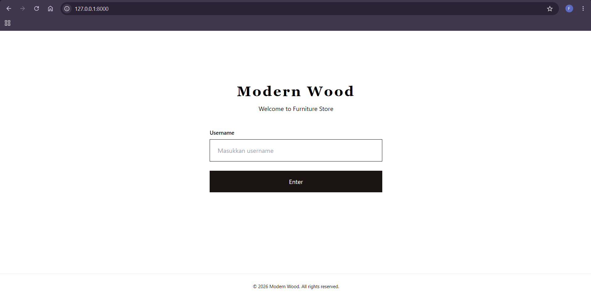
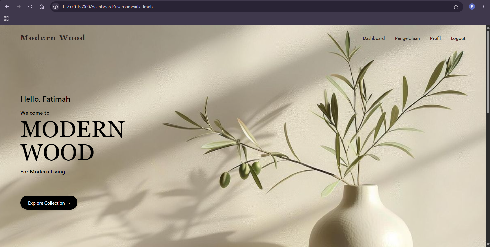
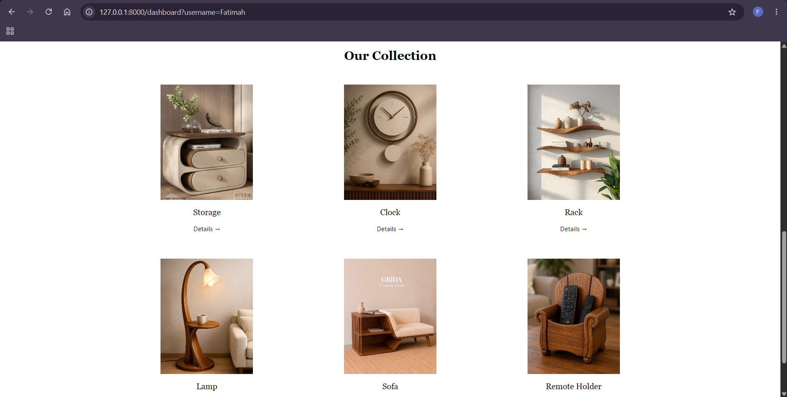
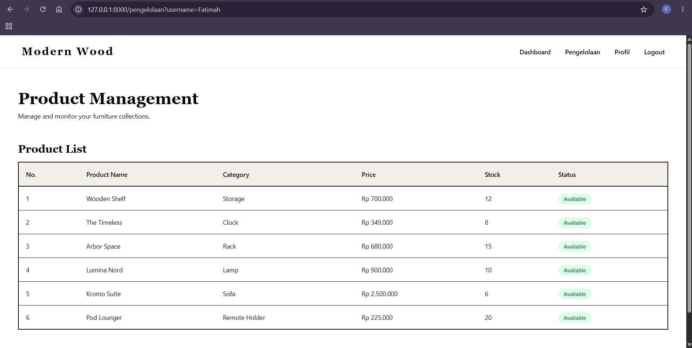
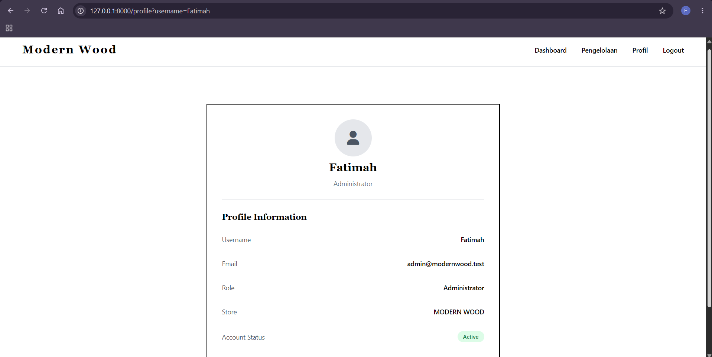

# Modern Wood

Website toko furnitur kayu sederhana yang dibuat dengan Laravel (pola MVC dan Blade templating) untuk UTS Pemrograman Web 2026. Tidak memakai database, semua data produk dikirim dari controller berupa array.

- Nama: Fatimah Azzahro
- NIM: 252410102015
- Program Studi:Teknologi Informasi

## Fitur

- Login dengan username, lalu diteruskan ke Dashboard dan Profil lewat request parameter
- Dashboard berisi koleksi produk dan popup detail produk
- Halaman Pengelolaan menampilkan daftar produk dalam tabel beserta status stok
- Halaman Profil
- Tampilan responsif, dengan menu hamburger di layar kecil

## Teknologi

- Laravel (PHP)
- Blade (`@extends`, `@section`, `@yield`, `@include`, dan `<x-footer />`)
- Tailwind CSS (CDN), CSS dan JavaScript biasa

## Struktur Utama

- `routes/web.php` untuk daftar route
- `app/Http/Controllers/PageController.php` untuk logika dan data
- `resources/views/layouts/app.blade.php` untuk layout utama
- `resources/views/` untuk view login, dashboard, pengelolaan, dan profile
- `resources/views/components/` untuk navbar dan footer

## Screenshot

### Login

### Dashboard

Tampilan awal:

Koleksi produk:

### Pengelolaan

### Profil

## Cara Menjalankan

composer install
cp .env.example .env
php artisan key:generate
php artisan serve

Lalu buka http://localhost:8000
